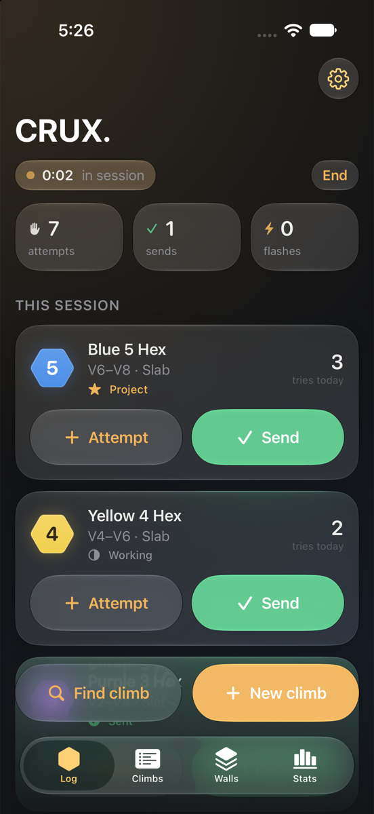
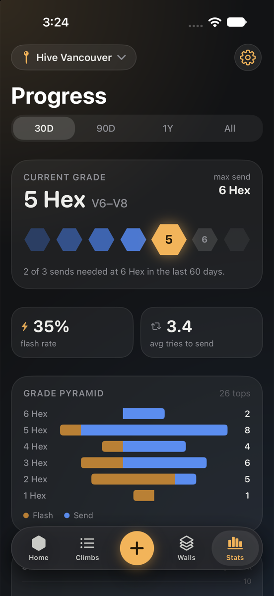
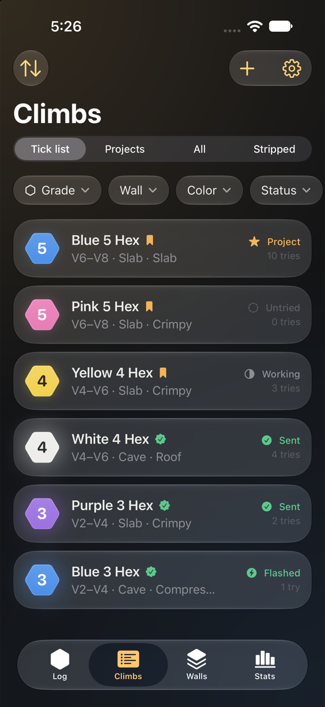
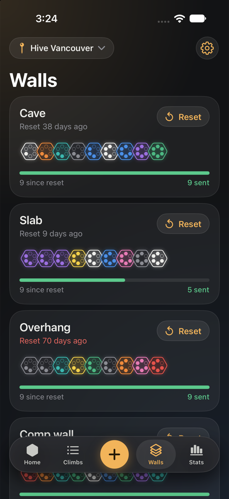

# CRUX.

**A calm, personal bouldering log for iPhone.** Log attempts and sends with one tap, and sessions start and end on their own. You can keep a tick list, track wall resets, and see where your climbing is going. Everything stays on your device.

It's built around the **Hex grading system** used at [Hive Climbing](https://hiveclimbing.com/climb-overview) in Metro Vancouver.

<p align="center">
  
  
  
  
</p>

## Features

**Logging at the wall**
- **Start session** with the ＋ in the middle of the tab bar. It opens a full-screen live session; while you climb, the button turns into **Session** so you can jump back in.
- Inside a session, add problems **from the wall** or create a **new climb**. Each one gets big **+ Attempt** and **Send** buttons.
- **Send-type inference**: a send on the first try is a *flash*, a send after failed tries is a *send*, and a send after an earlier send is a *repeat*. Long-press the send button to choose a different one.
- A four-second **undo** toast for every log.
- **End** shows a summary straight away. Sessions also wrap up on their own after a configurable quiet period, timed from your last log.
- **Multiple gyms** (e.g. Hive Vancouver, Surrey, Port Coquitlam), with a quick switcher and optional location-based auto-switching that never leaves the device.

**Organizing**
- **Tick list, Projects, All and Stripped** views, with grade-range, wall, hold color, status and style filters.
- Climbs become **projects** automatically after 5 tries without a send, or when you flag them.
- **Wall resets**: mark a wall as reset and its climbs move to the Stripped archive with their full history.

**Progress**
- A dashboard showing:
  - **current grade**: the highest grade with 3+ sends in the last 60 days
  - **max send**
  - **flash rate**
  - **average tries to send**
- A **grade pyramid**, **sends per grade over time**, and **tries-to-send by grade** (Swift Charts).
- A **style breakdown** with rule-based insights, such as *"You rarely send slab at 4 Hex+ — 1 of 6 sent, vs 52% overall."*
- **Session stats**:
  - volume
  - hardest send
  - attempts-per-send
  - a mini pyramid
  - a comparison with your recent sessions
- **Beta**: notes, plus photos and videos from the library or camera. Videos appear on the session timeline.

**Feel**
- A *Night Gym* design: dark-first, iOS 26 Liquid Glass, and a hexagon badge tinted with the hold color.
- Subtle springs, numeric content transitions, zoom navigation transitions, and Reduce Motion fallbacks.
- Haptics throughout, plus a custom **Core Haptics** pattern when you finish a project: three rising taps, then a warm swell.

## Hex grades

| Hex | 1 | 2 | 3 | 4 | 5 | 6 | 7 |
|---|---|---|---|---|---|---|---|
| ≈ V | VB–V0 | V0–V2 | V2–V4 | V4–V6 | V6–V8 | V8–V10 | V10+ |

These ranges come from Hive's published conversion and are approximate. Climbs store a plain integer grade behind a `GradeSystem` protocol, so another scale can be added without a data migration.

## Architecture

```
CRUX/
  App/            CRUXApp, RootTabView, AppModel (store + current gym), LogCoordinator (toast/undo/haptics)
  Models/         SwiftData: Gym, Wall, WallReset, Climb, Attempt, ClimbSession, BetaMedia; HexGrade, HoldColor, StyleTag
  Services/       SessionManager, SessionConfig, ResetService, StatsService, MediaStore, SeedData (DEBUG)
  Haptics/        HapticsService, ProjectSendHaptic (Core Haptics pattern)
  DesignSystem/   Theme tokens, HexBadge, glass components, FlowLayout
  Features/       Log, Climbs, Walls, Stats, Session, Beta, Settings
CRUXTests/        Swift Testing suites
```

- **Apple frameworks only, no third-party dependencies**: SwiftUI, SwiftData, Swift Charts, Core Haptics, PhotosUI and AVKit.
- **Client-side only.** There is no backend and no account. The SwiftData model avoids unique constraints and gives every property a default, so CloudKit sync could be added later.
- **`SessionManager`** owns the session lifecycle and all logging:
  - It takes an injected clock, which makes auto-close fully testable.
  - A session that closes on its own ends at its **last log**, not at the moment the timeout was noticed.
- **`StatsService`** is pure functions over the model, with no UI or persistence, so every metric is unit-tested.
- **Swift 6** with strict concurrency and MainActor default isolation. Value types are explicitly `nonisolated`.
- **Media** is stored as files in Application Support; SwiftData keeps only file names, so the store stays small.
- **Chart colors** are checked for colorblind separation against both the light and dark surfaces. Grades use a single-hue sequential ramp because they are ordered.

## Development-only tools

Debug builds add a **Developer** section to Settings, and none of it ships in Release:
- **Session timeout override** (30 sec, 2 min or 5 min), so auto-close can be tested in seconds
- Load sample data (about 10 weeks of history from a deterministic generator)
- Shift all data back a day
- Play the project haptic

There are also launch arguments for screenshots: `-seedSampleData YES -demoSession YES -tab stats`.

## Building

Requirements: Xcode 26 or later, iOS 26 SDK, and [XcodeGen](https://github.com/yonaskolb/XcodeGen) (only needed if you change `project.yml`).

```bash
git clone https://github.com/matthewphamm/crux.git && cd crux
open CRUX.xcodeproj        # pick an iPhone simulator and Run
```

To run on a device, copy `Config/Local.xcconfig.example` to `Config/Local.xcconfig` and set your `DEVELOPMENT_TEAM`. That file is git-ignored.

## Testing

```bash
xcodebuild test -scheme CRUX -destination 'platform=iOS Simulator,name=iPhone 17 Pro'
```

There are 35 tests (Swift Testing). They cover:
- Hex→V mapping
- send-type inference
- status and project rules
- session auto-start, auto-close and undo
- the debug timeout
- wall resets
- every dashboard metric, including insight thresholds
- filters

## License

MIT. Hex grade ranges courtesy of Hive Climbing; CRUX. is an independent personal project and is not affiliated with Hive.
